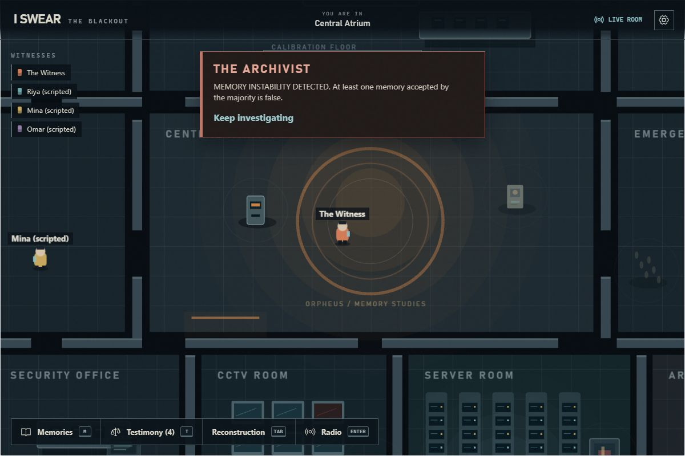

# I SWEAR

Same event. Different memories.

An explorable multiplayer mystery for 4-8 witnesses, with private corrupted memories, public testimony, reliable physical evidence, a shared reconstruction, and deterministic results. A solo rehearsal uses three clearly labelled scripted witnesses.



## Run locally

Backend (PowerShell):

```powershell
cd backend
py -3.11 -m venv .venv311
.\.venv311\Scripts\python.exe -m pip install -r requirements.txt
.\.venv311\Scripts\python.exe -m uvicorn app.main:app --port 8017
```

Frontend, in another terminal:

```powershell
cd frontend
npm install
npm run dev -- --port 5187 --strictPort --host 127.0.0.1
```

Open `http://127.0.0.1:5187`. Choose **Play solo demo**, or create a room and join its code from three more browser tabs. Once all witnesses are connected and ready, the host can begin.

WASD/arrow keys move, E inspects, M opens private memories, T opens testimony, Tab opens reconstruction, Enter opens radio, and Escape closes a dossier. The solo rehearsal lasts about three minutes; you can investigate and revise the scripted witnesses' theory before they vote.

Requirements: Python 3.11 and Node 22.12+ or 24. Use `npm ci` for reproducible installs. Touch direction buttons appear on small screens and coarse pointers. Sound, volume, and reduced motion are available from the gear button.

## Single-server release

Build the client, then start the backend. FastAPI serves `frontend/dist` and the API from one origin:

```powershell
cd frontend
npm ci
npm run build
cd ..\backend
.\.venv311\Scripts\python.exe -m uvicorn app.main:app --host 127.0.0.1 --port 8017 --no-access-log
```

Open `http://127.0.0.1:8017`. Invite links and saved replay links use the current origin. For remote devices, deploy behind HTTPS with WebSocket upgrades enabled and share that public origin. A loopback QR code is usable only on the same computer.

The portable container runs the same server:

```powershell
docker compose up --build -d
```

It serves port 8080 and stores SQLite in the `case-records` volume. The container definition is prepared; a container build has not been verified on this machine because Docker's engine is stopped. See [release notes](docs/RELEASE.md) for hosting requirements and verification.

## Persistence and Archivist

Rooms save to `backend/i_swear.db` by default. Refresh reconnects the same tab identity. Server restart restores positions, private memories, evidence, and reconstruction; active inputs and lock votes reset. Room saves occur after durable actions and every five seconds, so an abrupt crash can lose the latest few seconds of movement.

Copy `backend/.env.example` to `backend/.env` for optional settings. `DATABASE_URL` accepts SQLAlchemy URLs; PostgreSQL requires installing its driver and operating one game process. SQLite is the tested default.

The complete game runs with `ARCHIVIST_ENABLED=0` and no API key. To enable optional narration, set `ARCHIVIST_ENABLED=1`, `OPENAI_API_KEY`, and optionally `OPENAI_MODEL`. There are at most two room-wide requests per round, a four-second timeout, validated structured output, caching, and handcrafted fallback. No ordinary chat is sent to OpenAI. Canonical truth, evidence, movement, and scores remain deterministic. Real provider calls have not been tested with a key in this workspace.

The first round is the authored Blackout case. Rematches deterministically change casting, times, case objects, lab location, and portions of the sequence before the incident is frozen. Saved cases keep the exact canonical variant.

## Tests

```powershell
cd backend
.\.venv311\Scripts\python.exe -m pytest

cd ..\frontend
npm test -- --run
npm run build
```

With the server running, exercise a complete match through four real WebSocket connections:

```powershell
cd backend
.\.venv311\Scripts\python.exe scripts/smoke_match.py --url http://127.0.0.1:8017
```

This creates its own QA room, walks four witnesses through the facility, recovers four records, builds a timeline, locks by majority, waits for results, reads the saved replay, and rematches. It does not modify other rooms.

The [judge demo script](docs/DEMO_SCRIPT.md) describes a short presentation. [QA evidence](docs/QA.md) separates live checks from remaining coverage.

See [STATUS.md](STATUS.md) for verified progress and known gaps.
